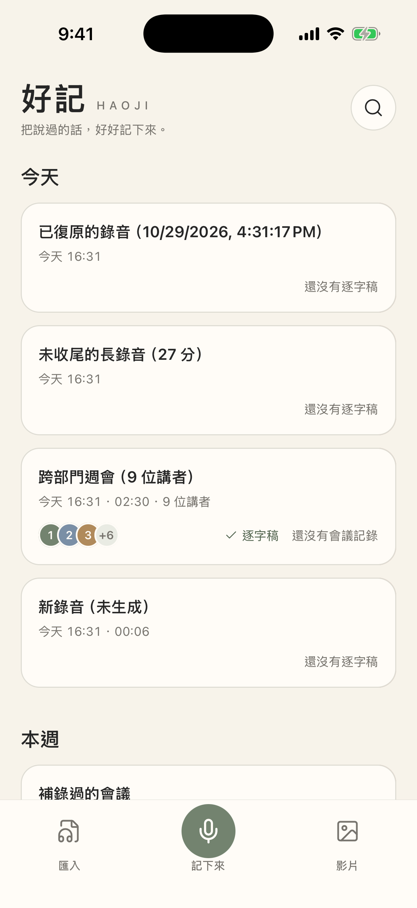
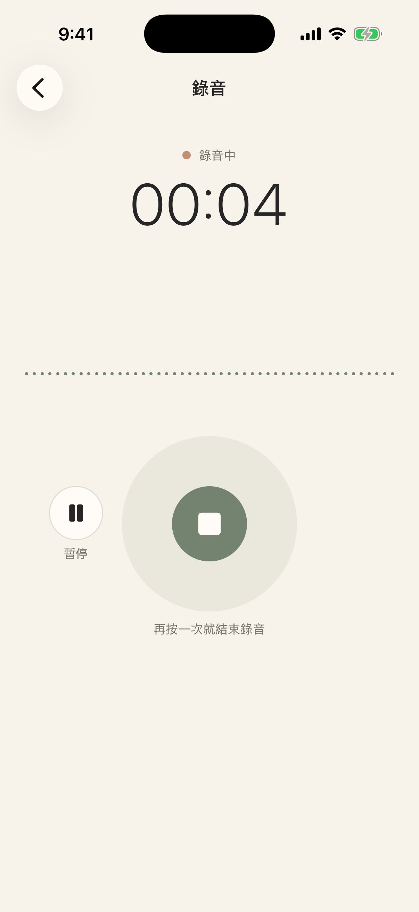
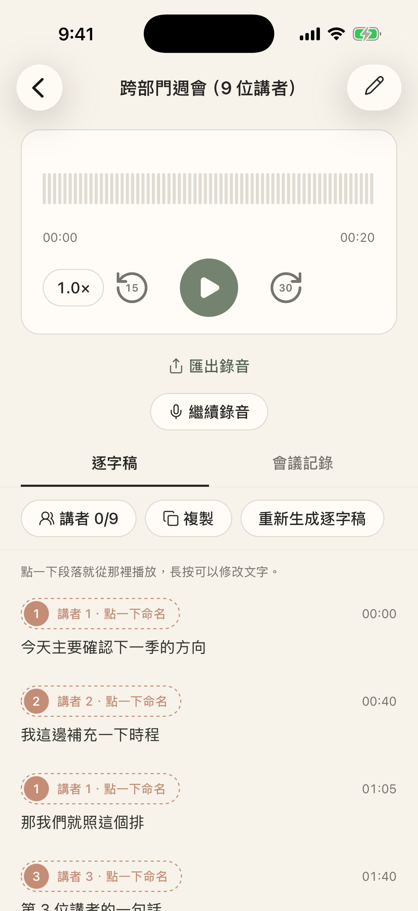
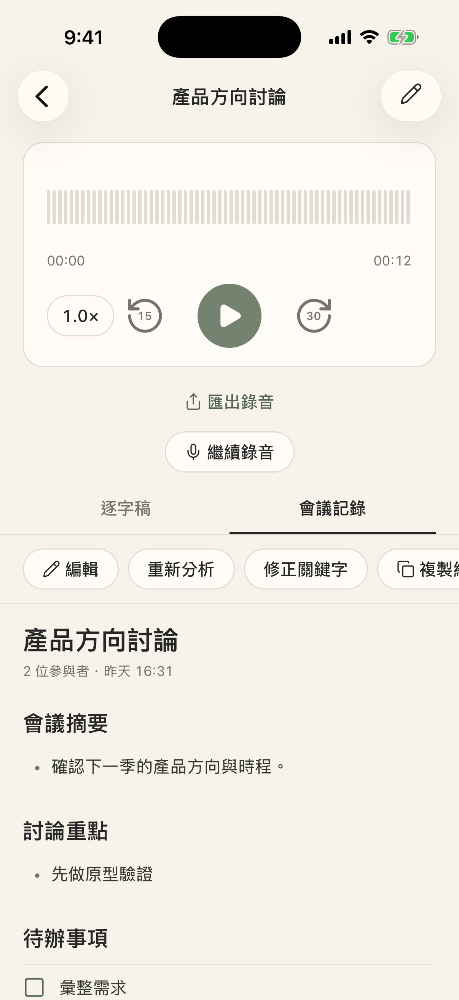
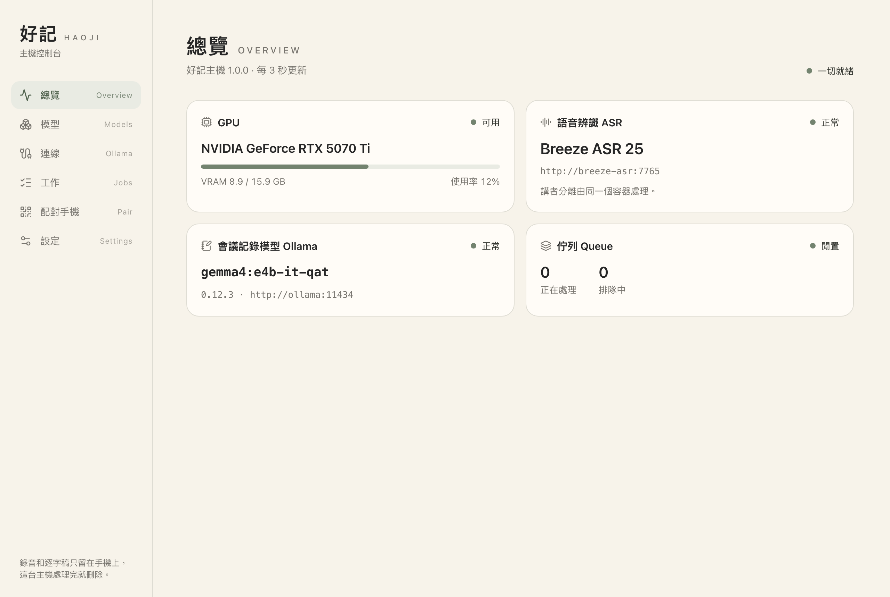
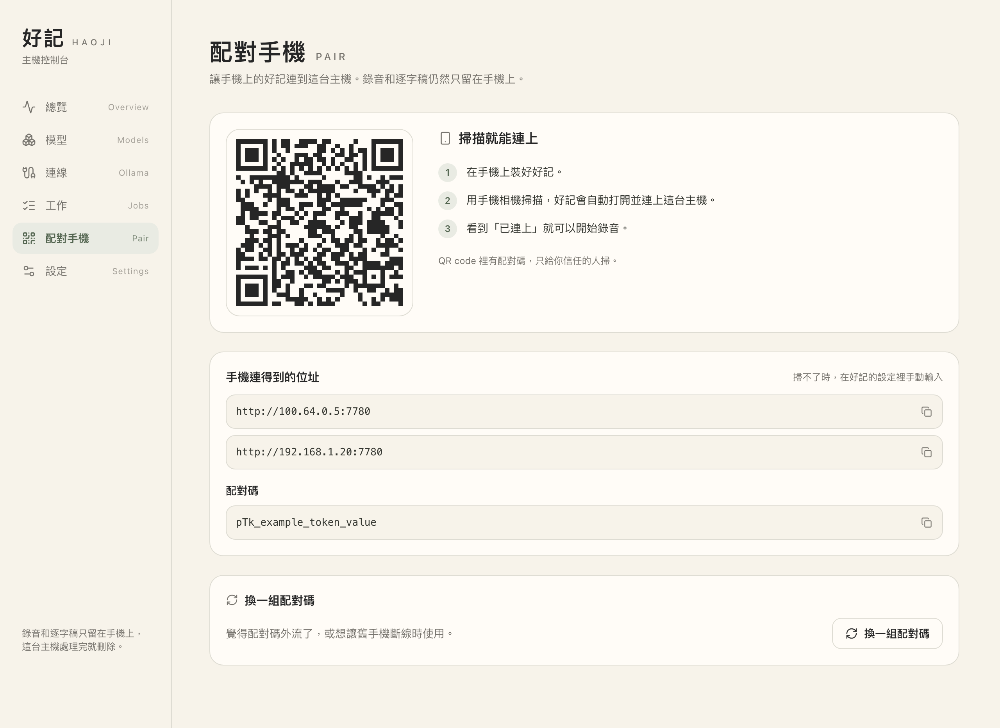

<p align="center">
  
</p>

<h1 align="center">好記 Haoji</h1>

<p align="center"><b>A meeting recorder that keeps what was said — on your phone, processed on your own GPU.</b><br/>
Record → speaker-separated Traditional-Chinese transcript → meeting notes. No account, no cloud.</p>

<p align="center"><a href="README.zh-TW.md">繁體中文</a> · <a href="#quick-start">Quick start</a> · <a href="#configuration">Configuration</a> · <a href="CONTRIBUTING.md">Contributing</a></p>

---

## Why

Meeting apps upload your conversations to someone else's servers. Haoji doesn't. The **phone** records and keeps
everything — audio, transcript, notes, speaker names. A **server you run** (any Linux box with an NVIDIA GPU)
turns audio into a diarized transcript with [Breeze ASR 25](https://huggingface.co/MediaTek-Research/Breeze-ASR-25)
+ pyannote, writes notes with a local LLM through Ollama, and forgets the audio as soon as it's done.

| | |
|---|---|
| 🎙 **Record anywhere** | Recording never needs the server — pause, resume, survive phone calls, process later. |
| 🗣 **Who said what** | Speaker separation, rename speakers once, tap a paragraph to play from there. |
| 📝 **Notes, not just text** | Purpose, decisions, action items per owner — in Traditional Chinese. |
| 🔒 **Yours** | No account. Results live on the phone; the server keeps nothing it doesn't need. |
| 🖥 **A real control console** | Status, GPU, models, Ollama connection, jobs, and phone pairing by QR code. |

<p align="center">
  
  
  
  
</p>
<p align="center">
  
  
</p>

## How it works

```
 Phone (iOS / Android)                         Your server (docker compose)
 ─────────────────────                         ───────────────────────────────────────────────
 record locally (WAV parts)  ── upload ──▶     haoji-backend :7780  ── /console (control panel)
 keeps transcript + notes    ◀─ results ──       │ ffmpeg concat → breeze-asr (ASR + diarization)
 pairs by QR (haoji://pair)                      │ notes → ollama (or any OpenAI-compatible API)
                                                 └ deletes audio when done; transcript after 24h
```

## Quick start

**You need:** Linux (or Windows + WSL2), an NVIDIA GPU with **≥ 16 GB VRAM** (≈ 9 GB peak in use),
Docker + Compose v2, the [NVIDIA Container Toolkit](https://docs.nvidia.com/datacenter/cloud-native/container-toolkit/),
and a free [Hugging Face token](https://huggingface.co/settings/tokens) with access to
[pyannote/speaker-diarization-3.1](https://huggingface.co/pyannote/speaker-diarization-3.1) (only to build the ASR image).

```bash
git clone https://github.com/romanticamaj/haoji && cd haoji/backend/deploy
cp .env.example .env            # set HF_TOKEN, and HAOJI_PUBLIC_URLS=http://<this-box-ip>:7780
docker compose up -d --build    # first boot downloads ~4 GB of models (5–20 min)
docker compose exec haoji-backend cat /data/admin_token
```

1. Open **`http://<this-box>:7780/console`** and sign in with the admin token.
   The Overview shows a checklist until speech recognition, Ollama and the notes model are all ready.
2. Go to **配對手機 Pair** and scan the QR code with your phone's camera — the app opens and connects.
3. Record a meeting. That's it.

Reach the box over your LAN, a VPN, or [Tailscale](https://tailscale.com) (`tailscale serve` adds HTTPS).
**Don't port-forward it to the internet** — see [SECURITY.md](SECURITY.md). Full deployment notes (pre-built
images, push notifications, troubleshooting): [backend/deploy/DEPLOY.md](backend/deploy/DEPLOY.md).

## Configuration

Set in `backend/deploy/.env`. Values marked *console* can also be changed in the control console
(a value set by its plain env var is locked there).

| Variable | Default | |
|---|---|---|
| `LLM_MODEL` | `gemma4:e4b-it-qat` | Notes model pulled into Ollama on first boot (*console*: pick any installed model) |
| `LLM_PROVIDER` | `ollama` | `openai` = use any OpenAI-compatible API instead (DeepInfra, OpenRouter, vLLM…) |
| `OPENAI_BASE_URL` / `OPENAI_API_KEY` | — | For `LLM_PROVIDER=openai` (*console*; the key is write-only) |
| `WEB_PORT` | `7780` | The only port published to the host |
| `HAOJI_PUBLIC_URLS` | — | Comma-separated URLs phones use to reach the box; the first goes in the QR code |
| `HAOJI_ALLOWED_HOSTS` | — | Extra hostnames to accept (IPs and `localhost` are always fine) |
| `HAOJI_ADMIN_TOKEN` | generated | Console sign-in; otherwise stored in `/data/admin_token` |
| `HAOJI_REQUIRE_TOKEN` | `0` | `1` = phones must be paired (recommended once they are) |
| `HAOJI_RETENTION_HOURS` | `24` | How long a finished transcript waits for the phone; `0` = until collected |
| `APNS_KEY_ID` / `APNS_TEAM_ID` | — | Optional iOS "transcript ready" push (key at `deploy/secrets/apns.p8`) |

## Build the app yourself

The app is bare React Native 0.81 (no Expo) for iOS and Android.

```bash
cd app && npm ci
npm run pods && npm run ios       # or: npm run android
```

Pair it from **設定 → 連接主機** or by scanning the console's QR code. To ship your own TestFlight build,
copy `app/ios/fastlane/.env.example` to `.env` with your App Store Connect key and run `fastlane beta`.

## Project layout

```
app/                 React Native app — lib/ (logic, unit-tested), screens/, components/
backend/             FastAPI server — sessions, ASR, notes, status, settings, pairing
backend/console/     Control console (Vite + React), served at /console
backend/deploy/      docker-compose unit: haoji-backend + breeze-asr + ollama
design/keeplace-style/  Design guideline, tokens and app icon
docs/                Specs and implementation plans
```

## Contributing

Tests come first, and every part has them — see [CONTRIBUTING.md](CONTRIBUTING.md).

## License

[MIT](LICENSE). Bundled models and third-party components keep their own licenses — Breeze ASR 25 (Apache-2.0),
pyannote (MIT), Gemma (Gemma Terms of Use), Ollama (MIT); see [backend/deploy/LICENSES.md](backend/deploy/LICENSES.md).
